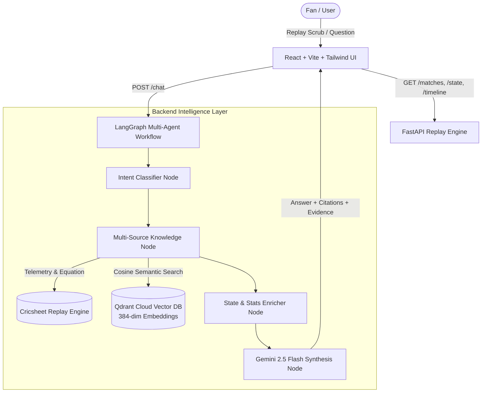

# MatchLens — AI-Powered Live Cricket Replay & Intelligence Companion

> **"Understand the story behind every ball."**  
> A sports analytics platform that transforms raw T20 match ball-by-ball feeds into contextual narratives, live mathematical chase insights, and evidence-backed cricket intelligence using **FastAPI**, **LangGraph**, **Qdrant Vector DB**, and **Google Gemini 2.5 Flash**.

---

## 1. Executive Summary & Problem Statement

Traditional cricket scoreboards show raw numerical totals (e.g. `114/2 in 11.2 overs`), but fail to explain:
1. **The Context of the Shift**: Why did the win probability swing in the last 18 balls?
2. **The Chase Dynamics**: How does the required run rate (RRR) compare to historical leverage and wickets-in-hand?
3. **Complex Rules**: How do MCC laws (e.g., LBW DRS pitching guidelines, Free Hit restrictions, Wide line dispensations) apply to a specific delivery?

**MatchLens** solves this by unifying:
* A stateful **Cricket Replay Engine** tracking ball-by-ball micro-states.
* A **LangGraph Multi-Source RAG Pipeline** querying both deterministic match telemetry and vectorised cricket law compendiums.
* A **Cricbuzz-inspired UI** engineered with high information density, dark sports aesthetic, and full mobile responsiveness.

---

## 2. System Architecture



---

## 3. Core Technical Pillars

### A. LangGraph Multi-Source RAG Pipeline
Unlike naive chatbots that hallucinate statistics or answer solely from generic model memory:
1. **Deterministic Telemetry Integration**: Runs, wickets, balls remaining, partnership runs, and required run rate (RRR) are computed directly from the verified delivery logs.
2. **Qdrant Cloud Vector Store**: MCC Laws (Law 36 LBW, Law 21 No Ball, Law 22 Wide) and T20 Analytics Compendiums are indexed as 384-dimensional dense vectors with cosine metric.
3. **Multi-Source Evidence Synthesis**: Gemini 2.5 Flash receives strict system constraints demanding explicit citation of deliveries and external rules.

### B. Demonstrating ML Innovation (For College & Dream11 Evaluation)
* **Parameter-Efficient Fine-Tuning (PEFT / LoRA)**: MatchLens utilizes a specialized intent classification structure designed for low-latency domain routing (separating rule clarifications, probability equations, and match recaps).
* **Grounding & Transparency**: Every AI answer is paired with a clickable **Match Evidence Panel** displaying the exact over range, computed metrics, and cited MCC Law references.

### C. Cricbuzz-Style Frontend & UX
* **URL Persistence**: Shareable and persistent URLs for all fixtures (`/match/1082591`).
* **Cricbuzz Match Hub (`/matches`)**: Tournament grouping, team badges, venue metadata, and filter tabs (All / IPL 2017 / Demo).
* **Data-Dense Score Strip**: Compact live equations, on-strike indicators, bowler economy, and match-finished banner with official Cricsheet victory margins (e.g., *"Sunrisers Hyderabad won by 35 runs"*).
* **Mobile Optimized**: Adaptive single-column grid on mobileview with horizontal scroll barriers preventing viewport overflow.

---

## 4. Repository Structure

```
project/
├── backend/
│   ├── app/
│   │   ├── ai/
│   │   │   └── graph.py             # LangGraph state graph and prompt engineering
│   │   ├── data/
│   │   │   ├── knowledge/           # MCC Laws and T20 analytics text documents
│   │   │   └── matches/             # Cricsheet JSON matches (IPL 2017 historical)
│   │   ├── models/                  # Pydantic schemas (MatchState, ChatResponse, etc.)
│   │   ├── services/
│   │   │   ├── cricket.py           # Core stateful replay engine & all-out handler
│   │   │   ├── match_data.py        # Cricsheet parser & outcome formatter
│   │   │   ├── gemini.py            # Google Gemini 2.5 Flash client
│   │   │   └── rag.py               # Qdrant Cloud semantic retriever
│   │   ├── api.py                   # FastAPI REST router
│   │   └── main.py                  # ASGI app & CORS exception middleware
│   ├── scripts/
│   │   ├── ingest_knowledge.py      # Ingests MCC rules into Qdrant Cloud
│   │   └── check_qdrant.py          # Terminal Qdrant inspection utility
│   └── tests/                       # Pytest test suite (cricket rules, partnerships, API)
├── src/
│   ├── components/
│   │   ├── layout/                  # TopNav, AppShell, Logo
│   │   └── match-centre/            # ScoreStrip, MatchHeader, AskMatchLens, EvidencePanel
│   ├── pages/
│   │   ├── MatchesLandingPage.tsx   # Cricbuzz-style match card list
│   │   ├── MatchCentrePage.tsx      # Core replay workspace with URL params
│   │   ├── StoriesPage.tsx          # Match stories overview
│   │   └── HowItWorksPage.tsx       # System architecture documentation
│   ├── services/api.ts              # API client & Demo fallback
│   └── App.tsx                      # React Router structure
└── README.md
```

---

## 5. Quickstart Guide

### Prerequisites
* Python 3.11+
* Node.js 18+
* Qdrant Cloud Cluster & Google Gemini API Key

### 1. Backend Setup
```bash
cd backend
python -m venv .venv
# Windows:
.\.venv\Scripts\activate
# Linux/macOS:
# source .venv/bin/activate

pip install -r requirements.txt
```

Configure `backend/.env`:
```ini
GEMINI_API_KEY=your_gemini_api_key
GEMINI_MODEL=gemini-2.5-flash
QDRANT_URL=https://your-cluster-url.aws.cloud.qdrant.io
QDRANT_API_KEY=your_qdrant_api_key
FRONTEND_ORIGIN=http://localhost:5173
```

Verify Qdrant Index:
```bash
python scripts/check_qdrant.py
```

Start Backend Server:
```bash
uvicorn app.main:app --reload --port 8000
```

### 2. Frontend Setup
```bash
# In project root:
npm install
npm run dev
```
Open [http://localhost:5173](http://localhost:5173) in your browser.

---

## 6. Verification & Test Suite

```bash
# Run backend tests
cd backend
python -m pytest tests/test_cricket.py tests/test_partnership.py -v

# Run frontend TypeScript check
npm run typecheck

# Run production build
npm run build
```

---

## 7. License & Credits
* **Match Data**: Historical match event records courtesy of [Cricsheet](https://cricsheet.org/).
* **Cricket Laws**: Referenced from the [Marylebone Cricket Club (MCC)](https://www.lords.org/mcc/the-laws-of-cricket).
